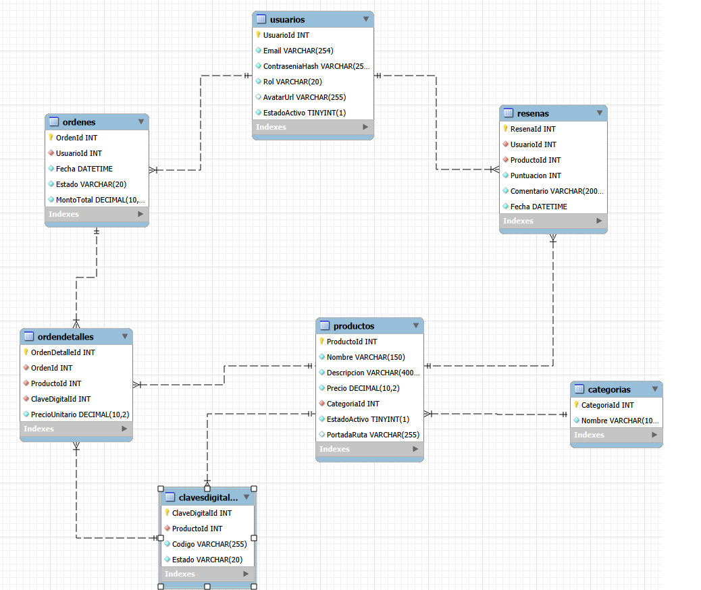

# ECommerce Juegos

## Descripción

Proyecto académico de comercio electrónico de claves digitales de videojuegos y software, con interfaz StoreJuegos. Usa ASP.NET Core MVC y compras simuladas: no integra una pasarela ni procesa pagos reales.

El Cliente puede registrarse, explorar el catálogo paginado, consultar stock, realizar compras simuladas, consultar las claves asignadas en su historial y reseñar productos adquiridos. El Administrador gestiona usuarios, categorías, productos y stock de claves mediante un módulo Vue con AJAX.

## Integrantes

- Tomas Abatedaga - abatedagatomas@gmail.com - @TomasAbatedaga - Discord: ztomy1
- Facundo Calderon - facu.eze.calderon@hotmail.com - @FacundoC2013 - Discord: facundoc2013

## Tecnologías y requisitos

- .NET SDK 10; ASP.NET Core MVC, C# y Razor.
- MySQL 8.0.16 o superior, con MySqlConnector y ADO.NET (sin Entity Framework).
- Bootstrap y Vue 3 Options API en Claves Digitales.
- Cookies para el sitio MVC; JWT para la API REST.
- Postman para probar la API.
- Acceso a Internet para cargar Vue y Bootstrap Icons desde sus CDN.

## Base de datos y DER

El esquema y los datos académicos están en [database/script.sql](database/script.sql). Abrir ese archivo desde MySQL Workbench o DBeaver y ejecutarlo en un servidor local para una base nueva. No es una migración ni un reinicio: no elimina tablas y fallará si ya existen. No ejecutarlo nuevamente sobre una base en uso.

Las siete entidades son Usuario, Categoria, Producto, ClaveDigital, Orden, OrdenDetalle y Resena. Sus tablas son Usuarios, Categorias, Productos, ClavesDigitales, Ordenes, OrdenDetalles y Resenas.

Hay relaciones 1:N, por ejemplo Categorías → Productos y Usuarios → Órdenes. La relación N:M entre Órdenes y Productos se resuelve mediante OrdenDetalle, con precio histórico y clave asignada.

## CONFIGURACIÓN LOCAL

Ejecutar los comandos desde la carpeta que contiene Proyecto-ECommerceJuegos.csproj. El proyecto ya tiene UserSecretsId: no hace falta ejecutar user-secrets init. Los siguientes valores son marcadores de ejemplo, no secretos reales.

~~~powershell
dotnet user-secrets set "ConnectionStrings:DefaultConnection" "Server=localhost;Database=ECommerceJuegos;User=root;Password=TU_PASSWORD;SslMode=none"
dotnet user-secrets set "TokenAuthentication:SecretKey" "TU_CLAVE_SEGURA"
~~~

Reemplazar TU_PASSWORD por la contraseña local y TU_CLAVE_SEGURA por una clave privada de al menos 32 bytes UTF-8. El marcador TU_CLAVE_SEGURA no cumple ese mínimo y debe sustituirse. Ajustar usuario, servidor y puerto de MySQL según la instalación. SslMode=none corresponde al ejemplo de conexión local.

No escribir contraseñas ni la clave JWT en appsettings.json. El archivo versionado conserva Password= vacío y no contiene SecretKey. User Secrets se carga en Development; en otro entorno se requiere configuración externa equivalente. La aplicación exige la clave JWT al iniciar, incluso para usar las vistas MVC.

## Ejecución

Con la base inicializada y la configuración local completa:

~~~powershell
dotnet restore
dotnet run --launch-profile https
~~~

El perfil https usa Development y declara https://localhost:7195 y http://localhost:5228. Abrir la URL HTTPS indicada en consola. Si el certificado local todavía no está confiado, ejecutar dotnet dev-certs https --trust. También se puede iniciar con dotnet run, usando la URL y el entorno indicados por el perfil seleccionado.

Para comprobar compilación después de restaurar dependencias:

~~~powershell
dotnet build --no-restore
~~~

## Roles y cuentas de demostración

- **Administrador:** administra usuarios, categorías, productos y claves. Puede cargar portadas y su avatar; no es el rol de compra.
- **Cliente:** consulta catálogo, compra de forma simulada, ve únicamente su historial, reseña productos adquiridos y carga su avatar. No administra entidades.

Las cuentas siguientes son exclusivamente de demostración y están definidas en el script SQL; no son credenciales de servicios reales:

| Rol | Email | Contraseña demo |
|---|---|---|
| Administrador | admin@example.test | AdminPrueba123! |
| Cliente | cliente@example.test | ClientePrueba123! |

Los INSERT guardan hashes de contraseña. El registro público crea Clientes. El cierre de sesión MVC se realiza por POST con antiforgery; no es un endpoint de revocación de JWT.

## Imágenes

- **Avatar:** Mi perfil → seleccionar imagen → Guardar avatar. JPG, JPEG, PNG o WebP, máximo 2 MB.
- **Portada:** un Administrador puede cargarla al crear o editar un producto. Mismos formatos, máximo 5 MB. Al editar sin archivo nuevo se conserva la portada actual.
- Los archivos se guardan localmente en wwwroot/Uploads/Avatares y wwwroot/Uploads/Productos, carpetas ignoradas por Git. Las imágenes subidas no se distribuyen con el repositorio.

## API REST

| Método | Ruta | Acceso |
|---|---|---|
| POST | /api/auth/login | Público; recibe email y contrasenia en JSON y devuelve token, expiración y datos de usuario. |
| GET | /api/productos?pagina=1 | Público; productos activos paginados. |
| GET | /api/productos/{id} | Público; detalle de un producto activo. |
| GET | /api/mis-compras?pagina=1 | JWT Bearer y rol Cliente; historial del usuario autenticado. |

Ejemplo de cuerpo para login, completando los marcadores localmente:

~~~json
{ "email": "EMAIL_CLIENTE_LOCAL", "contrasenia": "PASSWORD_CLIENTE_LOCAL" }
~~~

Las respuestas paginadas incluyen items, paginaActual, totalPaginas y totalRegistros. La cookie MVC no reemplaza el JWT de /api/mis-compras. Sin token válido se espera 401; un JWT de Administrador no cumple el rol Cliente y se espera 403. Los tokens emitidos vencen a las dos horas.

## Postman

Colección: [ECommerceJuegos.postman_collection.json](docs/postman/ECommerceJuegos.postman_collection.json).

1. Importar la colección en Postman.
2. Configurar baseUrl con la URL local real, por ejemplo https://localhost:7195, sin barra final.
3. Completar clienteEmail y clientePassword localmente con una cuenta Cliente de prueba.
4. Ejecutar **Login Cliente**.
5. Su script guarda el token devuelto en la variable token de la colección.
6. Ejecutar **Mis Compras con JWT** y las demás peticiones de la colección.

Probar también credenciales incorrectas, acceso sin token, token inválido o vencido, rol incorrecto y separación de historial entre clientes. La colección describe pruebas adicionales; sus resultados finales todavía deben producirse. No versionar tokens ni exportar credenciales o respuestas sensibles junto a las evidencias.

## Evidence Matrix

| Requisito | Implementación | Ubicación / Evidencia |
|---|---|---|
| Modelo de datos y relaciones | 7 entidades relacionadas, con relaciones 1:N y N:M mediante `OrdenDetalle`. | [DER](assets/diagrama.png) · [script.sql](database/script.sql) |
| Login, roles y perfil | Login/logout, roles `Administrador` y `Cliente`, perfil y carga de avatar. | [UsuariosController](Controllers/UsuariosController.cs) · [Captura de perfil con avatar](assets/perfil%20con%20avatar.png) |
| Manejo de archivos | Carga de avatar y portada de productos. | [UsuariosController](Controllers/UsuariosController.cs) · [ProductosController](Controllers/ProductosController.cs) · [Video de carga de portada](assets/subida%20de%20imagen%20de%20portada.mp4) |
| CRUD Vue + AJAX | Administración de Claves Digitales con Vue 3, altas, edición y eliminación sin recargar la página, más búsqueda AJAX de productos. | [Vista Vue](Views/ClavesDigitales/Index.cshtml) · PENDIENTE — video/GIF final del CRUD |
| Paginación de servidor | Paginación en Usuarios, Productos, Catálogo, Claves Digitales y Mis Compras. | [Partial de paginación](Views/Shared/_Paginacion.cshtml) · PENDIENTE — captura final |
| API REST + JWT | Login API, consulta de productos y endpoint protegido de Mis Compras mediante JWT. | [Controllers API](Controllers/Api/) · [Colección Postman](docs/postman/ECommerceJuegos.postman_collection.json) · PENDIENTE — evidencia final en Postman |
| Documentación y entrega | README, DER, script SQL, colección Postman e instrucciones para ejecutar y configurar el proyecto. | Archivos incluidos en el repositorio |